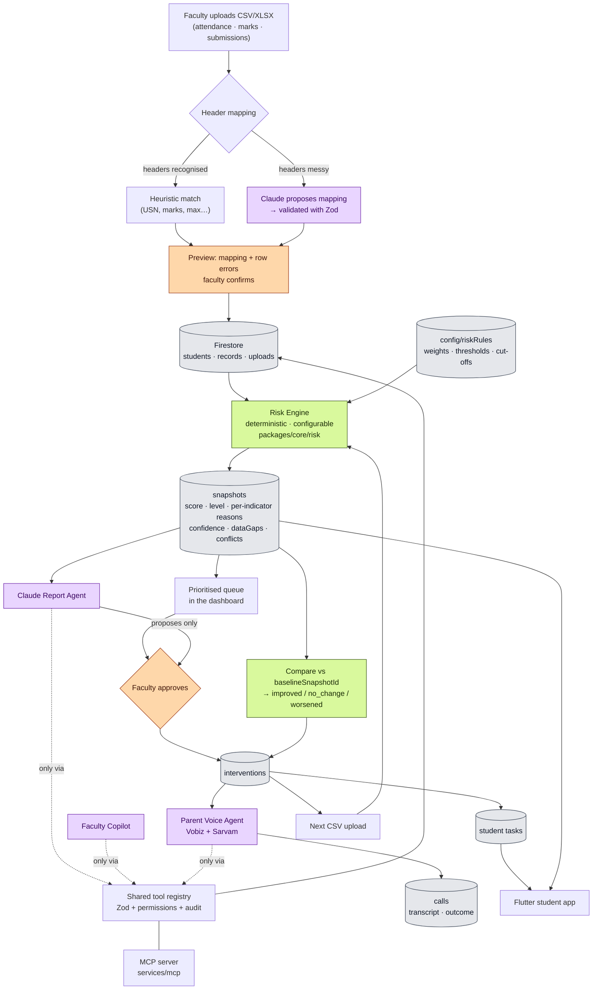

# EduPlus AI — Architecture

**CBC 2.0 · PS-055 · Team TONY STARK**

Early identification of students who need academic support, and tracking whether
the support actually worked.

---

## 1. The one idea

A deterministic engine decides **who is at risk**. Claude explains **why, and what
to do about it**. A human decides **whether to act**.

Those three responsibilities never blur, and that separation is the whole design:

| Concern | Owner | Never does |
|---|---|---|
| Risk score & level | `packages/core/risk` — pure, deterministic, unit-tested | Call an LLM |
| Explanation, recommendations, conversation | Claude, via the shared tool layer | Change a score |
| Consequential action (calls, approvals) | Faculty, in the dashboard | Get bypassed by an agent |

If a student asks "why was I flagged?", the answer is a number, a threshold and a
rule version — not a model output. That is what makes the system defensible, and
it is also what the problem statement asks for when it says **defined** risk
indicators.

---

## 2. Data flow



The loop closes at the bottom: an intervention is recorded, the next upload
recomputes risk, and the new snapshot is compared against the frozen baseline to
say whether the intervention helped. Nothing self-reports success.

---

## 3. Repository layout

```
apps/web          Next.js (App Router, TS, Tailwind) — faculty dashboard + API routes
apps/mobile       Flutter — student app (Android first)
packages/core     Zod schemas · risk engine · tool registry · repositories · prompts
services/mcp      MCP server exposing packages/core tools
services/voice    Fastify — telephony webhooks + audio (serverless can't hold a WebSocket)
firebase/         firestore.rules · indexes · seed · demo-reset
docs/             ARCHITECTURE · DESIGN · DEMO · SKILLS
sample-data/      demo CSVs
```

`packages/core` is the only place a business rule lives. The web app, the MCP
server and the voice service all import it; none of them re-implements scoring,
validation or permission logic.

---

## 4. Technology, and strictly what each is for

| Tech | Role | Explicitly not |
|---|---|---|
| **Next.js** | Faculty dashboard + server API routes (CSV import, recompute, agent endpoints). Holds all secrets server-side. | Not holding WebSockets — that is `services/voice` |
| **Firebase Auth** | Faculty (email) and student login. Custom claim `role = faculty \| student`. | Not storing parent contacts |
| **Firestore** | Single source of truth for every collection below. | Not computing anything |
| **Flutter** | Student app — reads only the signed-in student's own documents. | Never sees a parent phone number or another student |
| **Claude** (`claude-sonnet-5-5`) | Reports, recommendations, CSV header mapping, copilot, voice wording. | **Never computes a risk score** |
| **MCP** | Exposes the shared tools so agents and external Claude clients act through one audited interface. | Not a second data path |
| **Vobiz** | Outbound PSTN calls to parents. | Not an app; parents get phone calls only |
| **Sarvam AI** | Indian-language TTS/STT (Kannada, Hindi, English, +8). | Not translation of marks data |

Model id is read from `ANTHROPIC_MODEL` only. No model name is hard-coded
anywhere in the source.

---

## 5. Firestore data model

```
students/{usn}
  name, usn, semester, section, department, mentorId, authUid
  parent { name, phone, preferredLanguage }        ← faculty/server readable ONLY

students/{usn}/records/{recordId}
  type: attendance | assessment | submission
  subject, value, maxValue, date, sourceUploadId
  recordId is deterministic → re-importing the same CSV is idempotent

students/{usn}/snapshots/{snapshotId}              ← THE PROGRESS HISTORY
  score 0-100 (higher = more risk), level, academicComposite (higher = healthier)
  indicators { attendance, assessment, submission, trend }
    each: value, subScore, weight, recordCount, reason
  confidence, dataGaps[], conflicts[], insufficientData
  escalation { triggeredBy[], fromLevel, toLevel, reason } | null
  rulesVersion, previousSnapshotId, scoreDelta, createdAt

students/{usn}/reports/{reportId}
  body (structured JSON), rendered markdown, snapshotId, model, createdAt

students/{usn}/tasks/{taskId}
  title, description, dueDate, done, interventionId

uploads/{uploadId}
  fileName, recordType, uploadedBy, mapping, mappingSource, mappingConfidence,
  rowsTotal/Ok/Rejected, errors[], affectedUsns[], committedAt

config/riskRules
  rulesVersion, indicators{weight,threshold,criticalAt,minRecords}, levelCutoffs,
  minIndicatorsForScore

interventions/{interventionId}
  usn, type, reason, status, owner, dueDate, notes,
  baselineSnapshotId + baselineScore   ← frozen at creation
  outcomeSnapshotId + outcomeScore + outcome

calls/{callId}
  usn, purpose, language, status, provider, providerCallId,
  approvedMessage, approvedBy, transcript[], summary, parentResponse

audit/{auditId}
  actor{kind,id,agentName}, tool, args (redacted), status, durationMs, at
```

### Why two score directions

`score` runs 0–100 where **higher is worse**; `academicComposite` is a percentage
where **higher is better**. Both exist on purpose:

- `score` drives prioritisation and the "did it improve?" comparison — a drop is
  good news.
- `academicComposite` is what the trend indicator diffs against on the next run,
  and it is a kinder number to show a student than a risk score.

Mixing these up is the easiest bug to introduce here, so every function that
touches them says which direction it means.

---

## 6. The risk engine

Lives in `packages/core/risk`. Pure functions, 74 unit tests.

### Indicators

`attendance` · `assessment` · `submission` · `trend`

### One formula for all four

```
value >= threshold   → sub-score 0    (no risk)
value <= criticalAt  → sub-score 100  (maximum risk)
in between           → linear
```

Expressed as two human-meaningful numbers rather than a coefficient, so a
faculty member editing the Risk Rules page can predict what a change will do.
Linear on purpose: a curve nobody can explain has no business flagging a
student.

`trend` reuses the same formula with `threshold: 0` and `criticalAt: -12`,
because "a value below a bar I care about" describes a falling trend just as
well as low attendance.

**Thresholds sit above the institutional bars, deliberately.** 75% attendance is
the eligibility rule and 40% is the pass mark, but the default bands start at
90% and 65%. A system that waits until a student is already ineligible is not an
early-warning system. A student sitting exactly on 75% attendance scores 30 —
a real, visible concern rather than a green tick. These numbers were tuned
against the 30-student sample set: the shipped defaults give 24 distinct scores
across 30 students spread over all four levels, where pass-mark thresholds
collapsed 14 of them onto exactly zero.

### Aggregation

Numerators and denominators are summed, never percentages averaged. A student
who attended 5/50 classes in one subject and 10/10 in another is at **25 %**
(15/60), not the 55 % that averaging percentages reports. Averaging lets a small
subject mask a large failure — exactly the student this system exists to catch.

### Score

```
score = Σ(subScore_i × weight_i) / Σ(weight_i)    over AVAILABLE indicators only
confidence = Σ(weight of available) / Σ(all weights)
```

### The three edge cases

**Missing data.** An unavailable indicator is *excluded and re-normalised*, never
scored as zero risk. A student with only attendance data at 50 % scores 71.4
(the attendance band) with `confidence 0.35` — not ~25, which is what treating
the three missing indicators as "fine" would produce. Gaps are listed in
`dataGaps[]`, and below `minIndicatorsForScore` the snapshot is flagged
`insufficientData` and the UI shows "Insufficient data" instead of leaning on the
level. `minRecords` stops one stray mark from driving an indicator.

`minIndicatorsForScore` counts **academic** indicators only — `trend` is
derived from the other three, so counting it would let a student known purely
by their attendance stop being flagged as under-evidenced on their second
upload, just because a trend became computable.

**Conflicting indicators.** Recorded in `conflicts[]` rather than averaged away.
"Present every day but failing every test" and "absent and failing" can land on
the same score while needing completely different interventions — the average
hides that. Detection is restricted to the three academic indicators; `trend` is
excluded because it is derived from those same three, so pairing it against its
own inputs would report arithmetic as disagreement.

**Improvement after intervention.** `baselineSnapshotId` and `baselineScore` are
frozen when the intervention is created. When the next snapshot lands after
completion, `resolveInterventionOutcome` compares them and sets `improved` /
`no_change` / `worsened` (±2 points is treated as noise). It refuses to score
against a snapshot that predates `completedAt`, because crediting an
intervention with data collected before it finished would manufacture a result.

### Escalation — one bad indicator must not be averaged away

A weighted mean has a known failure mode: a student with 96% attendance and 18%
marks lands mid-scale, because good attendance dilutes a failing grade. On the
sample data that student scored 36.6 and was filed under **Watch**, which is
simply wrong — they are failing every assessment.

So when any single academic indicator reaches a configured severity
(`escalation.singleIndicatorSubScore`, default 85), the **level** is raised to a
floor (default At Risk). The **score is never touched** — it stays a plain
weighted mean anyone can recompute by hand — and the escalation is recorded
separately on the snapshot with its own plain-language reason, so the UI can
show *why* the level is higher than the number suggests.

This is what makes the conflicting-indicators edge case affect prioritisation
rather than merely displaying a badge. It is configurable and can be switched
off. `trend` is excluded, as everywhere else.

### Prioritisation

Level → score → worsening trend → **no open intervention** → USN. The fourth key
is deliberate: the queue answers "who has nobody on it?", not merely "who is
worst?". Insufficient-data students stay in the list — hiding them would turn
"we have no data" into "this student is fine".

### Predictive (stretch)

Least-squares line through the last 4 snapshot scores, projected one step ahead,
plus a what-if slider that reuses the real scoring path so it cannot drift from
what a real upload would produce. Both always render the label **Projection, not
a guarantee**.

---

## 7. The shared tool layer

One registry in `packages/core/tools` defines every action. The same definitions
are exposed as an **MCP server** and used by **every agent in the app**, each
with an allowlist of only the tools it needs.

| Tool | Report | Copilot | Voice |
|---|---|---|---|
| `get_student` | ✓ | ✓ | |
| `get_student_history` | ✓ | ✓ | |
| `list_at_risk_students` | | ✓ | |
| `get_risk_breakdown` | ✓ | ✓ | |
| `save_report` | ✓ | | |
| `propose_intervention` | ✓ | ✓ | |
| `update_intervention` | | ✓ | |
| `create_student_tasks` | | ✓ | |
| `get_call_context` | | | ✓ |
| `log_call_outcome` | | | ✓ |
| `schedule_parent_call` | | ✓ (proposes) | |

Every call is Zod-validated, permission-checked against the caller's allowlist,
and written to `audit` — **including refusals**, which are the evidence the
allowlist is actually working.

Consequential actions (`schedule_parent_call`, approving an intervention) require
a faculty action in the UI. Agents may only reach `proposed`.

### Why structured outputs, not forced tool use

The Report Agent must return a fixed JSON shape. On `claude-sonnet-5-5`, forced
`tool_choice` (`any` / `tool`) returns HTTP 400, and assistant prefill is also
rejected. So shape is guaranteed with `output_config.format` (structured
outputs) and the result is persisted by the server, rather than by trusting the
model to call `save_report` correctly.

---

## 8. Parent voice calls

Parents get **phone calls**. There is no parent app.

### Verified provider contracts

**Vobiz** (`https://api.vobiz.ai/api/v1`) — Plivo-style XML telephony.

- `POST /Account/{auth_id}/Call/`, headers `X-Auth-ID` / `X-Auth-Token`
- Body: `from`, `to` (E.164), `answer_url`, `answer_method`
- `answer_url` returns XML. Verbs: `Speak`, `Play`, `Gather`, `Record`,
  `Redirect`, `Hangup`, `Stream`
- `Play` needs a **public HTTPS** URL serving `audio/mpeg` or `audio/wav`
  (8 kHz mono recommended) — hence `PUBLIC_BASE_URL`
- `Gather` takes `inputType="dtmf speech"`, `numDigits`, `finishOnKey`,
  `executionTimeout`, and POSTs `Digits` / `Speech` to its `action`
- Callbacks: `ring_url`, `hangup_url`, `fallback_url`
- Bidirectional WebSocket audio: PCM L16 or μ-law, 8/16 kHz

**Sarvam** (`https://api.sarvam.ai`) — header `api-subscription-key`.

- TTS `POST /text-to-speech` — `bulbul:v4-flash`, `language_code` (**not**
  `target_language_code`), ≤ 2500 chars, returns **base64 WAV** in `audios[]`
- STT `POST /speech-to-text` — multipart, `saaras:v4`, 16 kHz preferred
- `saarika` is deprecated; do not use it

### Three tiers, so the demo cannot fail

1. **Simulated** (default, `TELEPHONY_PROVIDER=simulated`) — a browser fake call
   driving the *same* Sarvam + Claude pipeline. No phone, no network, demo-safe.
2. **Tier 1 — Vobiz DTMF.** Sarvam pre-generates the message audio, `<Play>`
   speaks it, `<Gather numDigits="1">` captures "press 1 to confirm". Outcome
   saved. This is the tier that must work.
3. **Tier 2 — live conversation.** `<Stream>` over bidirectional WebSocket →
   Sarvam STT → Claude → Sarvam TTS. Built only if everything else is solid.

Telephony sits behind a `TelephonyProvider` interface with `VobizProvider` and
`SimulatedProvider`, so the tier is an env var, not a code path.

### Guardrails

The voice agent receives `CallContext` — first name, parent name, language,
purpose, and the **approved message**. It is not given marks, the risk score or
the report. It cannot leak what it was never handed. It identifies itself as an
automated assistant from the college, makes no disciplinary decisions, offers a
mentor callback when a human is asked for, and dials only a number stored on the
student record.

---

## 9. Security model

- Parent phone numbers: faculty/server only. Firestore rules deny them to
  student-role clients, and `PublicStudentSchema` strips them server-side as
  defence in depth.
- Students read only their own documents, enforced by rules and tested.
- All secrets server-side. The Flutter app and the browser bundle hold none.
  Firebase client config is public by design — access is controlled by rules,
  not by hiding an API key.
- Audit log redacts phone numbers to `+91•••••••89`, keeping enough to tell two
  parents apart without the log becoming a directory of personal numbers.
- Zod validates at every boundary: CSV rows, tool arguments, agent output,
  webhook payloads.

---

## 10. Build order

| Hours | Deliverable | State |
|---|---|---|
| 0–1 | Repo, skills, design tokens, Firebase, env, schemas | done |
| 1–5 | CSV import + auto-mapping + Firestore + seed data | |
| 5–8 | Risk engine + configurable rules + snapshots + prioritised dashboard | engine done (74 tests) |
| 8–10 | Interventions + progress history + before/after | outcome logic done |
| 10–12 | Tool registry + MCP server + Report Agent + Copilot | |
| 12–15 | Voice Tier 1 (Vobiz + Sarvam) + SimulatedProvider | |
| 15–18 | Flutter student app | |
| 18–20 | Polish, tests, Playwright run, DEMO.md, rehearse | |

**Out of scope:** Telegram bot, ESP32/IoT hardware, parent app.
